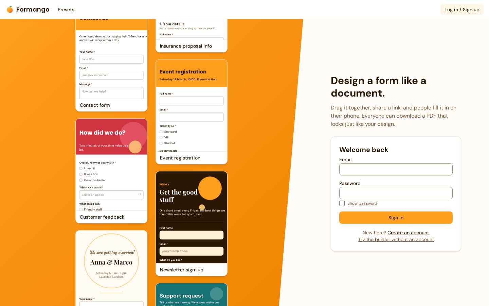

# Formango

Design a form like a document, share a link, let people fill it in on their phone, and download a PDF that looks just like your design.



**Live demo:** _add the Cloudflare Pages link here after deploying (see "Deploy" below)._

## What it does

- **A canvas builder** (like Canva) with text, shapes, lines, images, nine field types, snapping, undo and redo, zoom, layers, align and distribute, and keyboard shortcuts.
- **Fields:** short and long text, dropdown, checkbox, radio, date, signature (draw, type, or upload), file upload (allowed types and size limit), and a **repeating group** ("Add person") that lets a respondent add as many entries as they need.
- **Fill page:** works on phones, validates as you go, turns boxes green when they are filled, and shows a thank-you screen.
- **PDF:** a filled copy that matches the design, and a **fillable blank PDF** with real form fields. Both are made in the browser.
- **Accounts and sharing:** sign up, save forms, publish a link, close it again, and see **responses** in a table with search, a side panel, per-response PDF, and CSV export.
- **Nine templates**, including a long insurance information sheet and an A4 job application.
- No ads, no tracking, no third-party scripts or fonts.

## Tech and why

| Choice | Why |
|---|---|
| Vite, React 19, TypeScript (strict) | Fast, and the type checker guards the one shared document format |
| Tailwind v4 and shadcn/ui | Small, accessible parts styled from one theme file |
| Zustand and zundo | A plain document store with undo that never touches UI state |
| react-moveable | Drag, resize, and rotate mechanics. Snapping is our own tested code |
| Zod | Every file, saved form, and import is validated before it is trusted |
| pdf-lib and fontkit | PDFs drawn in the browser (no server), loaded only when needed |
| Supabase | Accounts, Postgres, and Storage on the free tier, protected by Row Level Security |
| Vitest, Playwright, axe | Unit tests, real-browser tests in Chromium and Firefox, accessibility checks |

## How it is built

```
            +-----------------------------+
            |  FormDoc (one JSON document)|
            +--------------+--------------+
                           |
   +-----------+-----------+------------+-------------+
   |           |                        |             |
Builder    Preview /               PDF exporter   Supabase
(edit)     Fill page               (pdf-lib)      (forms.doc jsonb)
   \_________/                          |
  shared element renderers        draws the same coordinates
```

- **One document.** The builder, the fill page, the PDF, and the database all read the same JSON (`src/types/doc.ts`, `docs/schema.md`).
- **One set of renderers.** `src/components/elements` draws elements for the editor, the preview, the fill page, and thumbnails.
- **One text layout engine.** `src/lib/text/layoutText.ts` breaks text into lines by summing per-character widths. The screen and the PDF draw those same lines, so wrapping never differs. A browser test renders every template both ways and compares pixels.
- **Gestures write once.** Dragging and resizing move the DOM only and save a single undo step when you let go.
- **Row Level Security is the security.** Nobody can read a form's draft except its owner. Respondents read the published copy through one database function. `node scripts/rls-check.mjs` tries 27 forbidden things against the real project.

## Run it yourself

```bash
npm install
cp .env.example .env.local     # then fill in the two values below
npm run dev
```

1. Make a free project at supabase.com.
2. In the SQL editor, run `supabase/schema.sql` (and, if your database was made earlier, `supabase/migrations/*.sql`).
3. Authentication, Sign In / Providers, Email: turn **Confirm email** off for the demo. The free mailer only sends a few emails an hour.
4. Put the project URL and the **publishable** key in `.env.local`:
   ```
   VITE_SUPABASE_URL=https://<your-project>.supabase.co
   VITE_SUPABASE_PUBLISHABLE_KEY=sb_publishable_...
   ```
   Never use or commit the `service_role` key. The builder works without Supabase as a guest (saving in the browser).

| Command | What it does |
|---|---|
| `npm run dev` | Dev server |
| `npm run check` | Lint, types, unit tests, contrast check, build, and browser tests |
| `npm run check:fast` | Lint, types, unit tests |
| `node scripts/rls-check.mjs` | Security test against your Supabase project |
| `E2E_CLOUD=1 npx playwright test e2e/cloud.spec.ts --project=chromium` | Full sign up, publish, and respond test (makes throwaway accounts) |

## Deploy (Cloudflare Pages, free)

1. Push this repository to GitHub.
2. Cloudflare dashboard, Workers and Pages, create a Pages project from the repository. Framework: Vite. Build command `npm run build`, output `dist`. Add `NODE_VERSION` (22 or newer) and the two `VITE_` variables.
3. In Supabase, Authentication, URL Configuration: set the Site URL to your Pages address.
4. `public/_redirects` makes page refreshes work, and `public/_headers` adds the security headers and Content Security Policy. Test them before relying on them: `npm run build && node scripts/serve-dist.mjs` serves `dist/` with the same headers.
5. Keep the free database awake: in GitHub, Settings, Secrets and variables, Actions, Variables, add `SUPABASE_URL` and `SUPABASE_PUBLISHABLE_KEY`. The weekly workflow in `.github/workflows/keepalive.yml` pings it.
6. Put your address on the "Contact" line in `src/pages/Privacy.tsx`.

## Decisions worth knowing

All of them are written down with reasons in [`docs/decisions.md`](docs/decisions.md). A few:

- The Submit button is a real element, so designers can place and style it, but it cannot be deleted.
- A repeating group stores a height for one sample entry. Real heights are computed, and everything below a group moves as entries are added, on screen and in the PDF.
- Form drafts autosave with a conditional update, so a second tab cannot silently overwrite the first (you get a Reload or Overwrite choice).
- Public forms never expose the draft. A published form is a copy taken at publish time.

## Limits and roadmap

- Fonts are Latin only (seven families). Other characters become `?` in PDFs, with a warning.
- A long mobile form exports as one tall PDF page, not A4 pages.
- The responses page loads the newest 1000 responses.
- Not built yet: multi-page forms, conditional logic ("show this if..."), email notifications, teams, CAPTCHA, custom fonts, dark mode.
- Fillable PDFs were checked in pdf.js only. Try them in Acrobat and a phone viewer.

## What I learned

- Keeping screen and PDF text identical took a spike first: browsers round glyph widths and apply kerning and ligatures, while PDF libraries do not. Measuring per-character widths and turning kerning off made all three agree.
- A visual regression test that renders the same document two ways caught several off-by-a-pixel bugs that no unit test would have.
- Treating the data format as the product (one JSON, validated everywhere) made features like repeating groups, templates, import, and export fall out almost for free.
- Security belongs in the database. Writing the "what must not be possible" tests first found a policy that silently blocked respondents.
